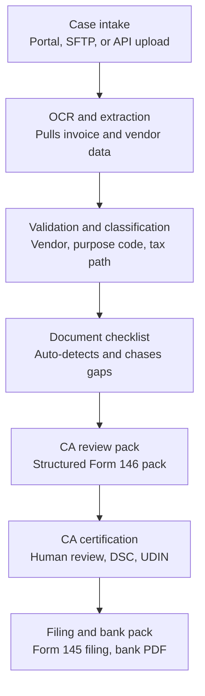
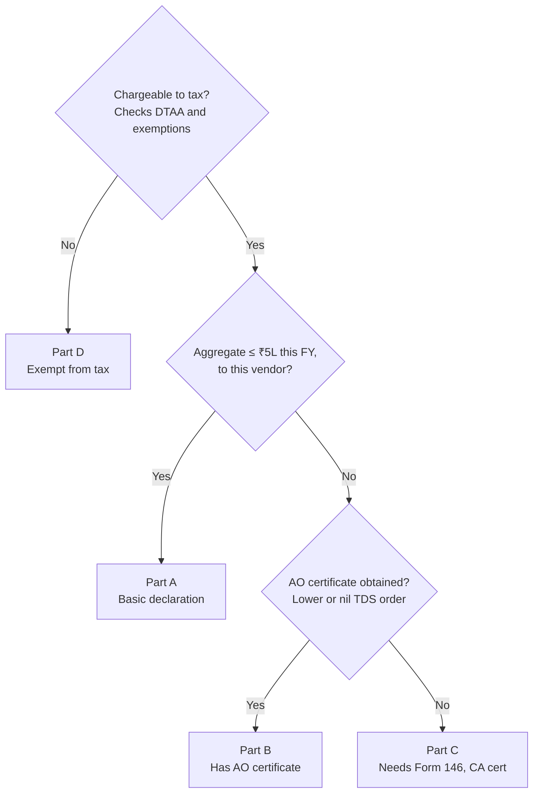
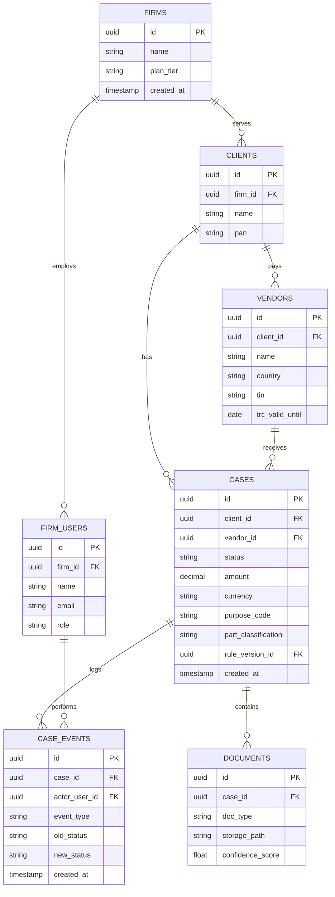
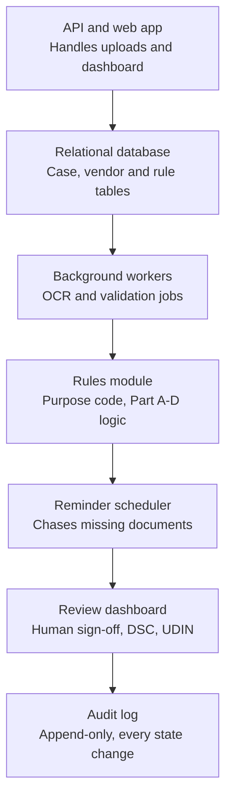
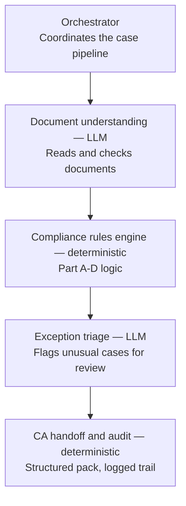

# CA-Firm Form 145/146 Automation Platform

## What this is

A SaaS workflow platform sold to Indian Chartered Accountant (CA) firms to automate
the operational grind around Form 145/146 (formerly Form 15CA/15CB), the filings
required whenever an Indian business remits money to a foreign vendor.

The platform does NOT replace the CA. It automates everything around the
certification step: document intake, OCR/data extraction, vendor validation,
tax-path classification, document-gap chasing, and bank-ready package generation.
The CA still reviews, certifies with DSC, and generates UDIN. That step is never
automated, full stop.

Status: pre-code. This file exists to give a coding agent the full design and
business context before any implementation starts. Nothing described below has
been built yet.

Sources: two internal business planning documents ("Form 15CA/15CB Automation —
Commercial, Operational and Pricing Model" and "CA-Firm SaaS Business Model —
Form 145/146 Automation"), plus follow-on design discussion. Referred to below as
**Doc A** and **Doc B**.

## Contents

1. Non-negotiables
2. Tech stack
3. Regulatory context
4. Business model
5. Go-to-market strategy
6. Pricing
7. Unit economics and cost model
8. Financial projections
9. Risks and mitigations
10. Case lifecycle (diagram)
11. Classification logic (diagram)
12. Data model (diagram)
13. System architecture (diagram)
14. Orchestrated / intelligent pipeline (diagram)
15. Review dashboard concept
16. Suggested build order
17. Explicitly out of scope

---

## 1. Non-negotiables

- **CA certification stays human.** DSC signing and UDIN generation are manual
  steps performed by the CA in the review dashboard. Never build automation that
  bypasses, pre-fills without review, or auto-approves this step.
- **Tax classification (Part A/B/C/D) is deterministic, not LLM-driven.** It's a
  fixed, versioned rule set. Every case must record which rule version classified
  it.
- **Multi-tenant from day one.** A CA firm is the tenant. Every table that holds
  case-related data must be scoped by `firm_id`, enforced with Postgres row-level
  security, not just application-layer filtering.
- **Certification fees, bank charges, and tax opinions are never priced into the
  platform.** The product sells workflow software only (Doc A, Doc B — both are
  explicit and consistent on this). Bundling CA certification into a cheap plan
  is called out in Doc A as the single most likely way to make the business
  unprofitable. Keep this boundary visible in any billing/pricing code.
- **No cloud vendor lock-in assumed.** Object storage should be written against
  an S3-compatible interface, not the AWS SDK specifically.

This stack was chosen by default (nothing about the domain requires it) — flag
it if you want to change direction, don't just silently deviate.

## 2. Regulatory context

Form 15CA is being renamed Form 145; Form 15CB is being renamed Form 146. Form
145 is filed by the remitter (the Indian party sending money abroad); Form 146
is the CA's certificate, required before certain categories of Form 145 can be
filed. Roughly 44–45 lakh such filings have been made annually on average over
the past five years (official Income Tax Department note — source S1 in both
Doc A and Doc B).

The same official note lists the operational problems that motivate this
product: clerical data entry errors, exchange-rate mismatches between the filing
and the actual remittance, duplicate capture of the same transaction by the
authorised dealer (bank), and repeated re-filings needed to correct a single
mistake.

Filing is event-based: one Form 145 per remittance, no annual consolidated
filing. This is why the data model is one row per case, not a batched monthly
record.

Separately: remittances for specified transactions (e.g. overseas investment
under LRS) exceeding ₹10,00,000 in a financial year may trigger 20% TCS. This
sits outside the Part A–D branch — surface it as a case-level warning, don't
hard-branch on it.

## 3. Business model

### 3.1 Three possible service shapes (Doc A)

| Model | What it includes | Why it works | Risk |
|---|---|---|---|
| Software-only SaaS | Platform prepares workflow, data, document checklist, audit pack; CA/client does certification and filing | Best margin, lowest liability, easiest to scale | Requires customer to already have CA and tax capability |
| Assisted compliance service | Platform + internal ops team + partner CA support; customer gets guided completion | Higher revenue and customer stickiness | Higher cost, CA liability, service dependency |
| Bank/AD compliance middleware | API/white-label module helping banks validate Form 145/146 data, ITDREIN, consumed forms, remittance packs | Large contracts, high trust, strategic moat | Long sales cycle, procurement, infosec, integration, legal review |

Doc A's recommendation: start with software-only, treat the other two as
later-stage options — they carry progressively more liability and a longer
sales cycle.

### 3.2 The narrower model this project follows (Doc B)

Doc B narrows the above to a single, cleaner model: **sell only to CA firms**,
not individual companies, not banks, at this stage. Reasoning:

- One CA firm already does this filing work for many clients → one firm
  onboarded = many remittance cases, not a one-off sale
- The firm already understands the regulatory pain, no market education needed
- The platform never touches the CA fee, bank charges, or tax opinion — those
  stay with the CA firm and their client
- Primary revenue: monthly SaaS subscription + extra usage + onboarding +
  white-label/API

This is the model this codebase should be built for.

### 3.3 Business model assumptions (Doc A)

- Exchange rate used for planning: AED 1 = INR 22.75 (Doc A); Doc B uses
  ₹22.7/AED as an indicative conversion, INR as primary currency
- Product scope: workflow automation, data extraction, decision support, portal
  data preparation, filing assistance, document package, audit archive
- **Not in scope without separate authorization:** holding client funds, acting
  as a payment aggregator, giving unaudited tax opinions, replacing CA judgment,
  bypassing DSC/EVC or portal controls
- Primary user: finance/AP team, tax team, CA firm staff, CFO/controller,
  bank/AD operations team
- Revenue recognition: annual subscription upfront preferred; monthly available
  only at a 15–20% premium

## 5. Go-to-market strategy

### 5.1 Staged path (both docs agree on this order)

CA firms first → direct corporates → ERP/AP integrations → banks/authorised
dealers last. Banks should never be the first-year survival plan — Doc A is
explicit that bank sales cycles run 9–18 months and shouldn't be depended on
early.

| Route | Typical sales cycle | Pre-sales cost (Doc A) | Probability | Why it comes at that stage |
|---|---|---|---|---|
| CA / accounting firms | 1–3 months | AED 8,000–20,000 | High | Low trust barrier; one firm brings 20–200 clients |
| SME / direct corporates | 1–4 months | AED 1,500–8,000 | Medium-high | Good for Starter/Growth plans; needs education and support |
| Mid-market / large corporates | 3–6 months | AED 15,000–50,000 | Medium | Higher ARPA; needs approvals, security, integration |
| ERP/AP partners (Tally, Zoho, Odoo, SAP B1) | 4–9 months | AED 80,000–300,000 | Medium | Embeds into existing AP workflow once proven |
| Banks / authorised dealers | 9–18 months | AED 300,000–1,200,000 | Low initially, high later | Procurement, InfoSec, legal, liability review |

### 5.2 Predicted outcomes by path (Doc A)

- CA-first path: 10 firms in 6 months → ~AED 750,000
- Corporate-direct path: 50 companies in 9 months → ~AED 900,000
- ERP/AP integration path: 2 integrations in 12 months → ~AED 500,000
- Bank path: 1 pilot in 12–18 months → AED 250,000–750,000

### 5.3 Bank sales (later-stage, reference only)

Not part of the near-term build, but documented for context. Bank value
proposition: standardised digital remittance compliance pack, validation
dashboard, consumed/unconsumed Form 145 ledger, exception queue, audit
evidence. Bank buyer: trade finance, forex ops, compliance, tax reporting,
corporate banking ops. What banks will ask for: security certifications, data
localization, API docs, audit logs, DR/BCP, legal liability, indemnity, uptime
SLA, VAPT, access controls. Approach only after 1,000+ successful filings, 10+
CA partners, 25+ corporate clients, and independent security testing.

Suggested bank offer packaging (Doc A): Bank Pilot AED 250,000 / 3–4 months;
Bank Annual License AED 450,000/year; Bank Enterprise/White Label AED
900,000–1,800,000/year; Implementation fee AED 250,000–600,000 one-time.

## 6. Pricing

### 6.1 CA-firm subscription plans — this is the pricing model to build for (Doc B)

| Plan | Monthly price | Included remittances | Extra remittance | Gross margin |
|---|---|---|---|---|
| CA Starter | ₹25,000 | 25/month | ₹700 | 80% |
| CA Growth | ₹60,000 | 100/month | ₹550 | 71% |
| CA Pro | ₹1.2 lakh | 300/month | ₹400 | 69% |
| CA Enterprise | ₹2.5 lakh | 800/month | ₹300 | 71% |
| CA Network / White Label | ₹5.0 lakh | 2,000/month | ₹200 | 72% |

Minimum viable entry price: do not go below ₹25,000/month for the entry plan
(Doc B).

### 6.2 Add-on / cost-buffer pricing (Doc B — price these separately, never bundle)

| Add-on | Suggested price |
|---|---|
| Onboarding / setup | ₹25,000–₹2,00,000 depending on firm size |
| White-label setup | ₹1L–₹5L setup fee |
| Extra branch / user pack | ₹5,000–₹25,000/month |
| Urgent correction / refiling support | ₹2,000–₹7,500 per case |
| ERP integration | ₹1L–₹10L one-time |
| API access | ₹50,000+/month |
| Dedicated support SLA | ₹25,000–₹1L/month |
| Historical data import | ₹25,000–₹3L |
| Custom bank package templates | ₹25,000–₹2L |
| Security testing / legal terms / insurance | Budget annually, fold into operating cost |

### 6.3 Broader pricing ladder from Doc A (reference — for the wider three-model business, not the CA-only build)

| Plan | Annual price | Included remittances | Overage |
|---|---|---|---|
| Starter | AED 5,000 | 10/year | AED 275 |
| Growth | AED 18,000 | 50/year | AED 225 |
| Business | AED 42,000 | 150/year | AED 175 |
| CA Partner | AED 75,000 | 750/year | AED 85 |
| Enterprise | AED 120,000 | 600/year | AED 110 |
| Bank/AD White-Label | AED 450,000 | Custom | AED 20 |

Minimum sell rules from Doc A: minimum viable sell price AED 5,000/year;
absolute floor AED 4,500/year (pilots, annual upfront, software-only scope
only); minimum per additional remittance AED 225; minimum CA-inclusive
remittance price AED 450; minimum bank annual license AED 300,000.

**What must always be excluded from low-tier plans** (Doc A): CA certification
fee and UDIN generation; bank outward remittance charges and FX spread; formal
legal/tax opinion for complex DTAA/PE/royalty/FTS/AO-order cases; more than one
correction cycle after customer-caused mistakes; custom ERP/API integration,
SSO, dedicated environment, bank-grade DR, special reports.

## 7. Unit economics and cost model

### 7.1 Operational cost per remittance — 13 steps (Doc A)

| # | Step | Est. cost (AED) | Notes |
|---|---|---|---|
| 1 | Customer request / invoice intake | 5–20 | One-time setup cost higher for first remittance |
| 2 | OCR and data extraction | 1–4 | Near-zero at scale with confidence scoring |
| 3 | Vendor/remittee validation | 5–20 | First-time vendor costs more; repeat vendor costs less |
| 4 | RBI purpose code classification | 2–10 | High-risk categories need tax SME review |
| 5 | Taxability and threshold check | 3–10 | Must retain reason codes and evidence |
| 6 | Document gap follow-up | 10–35 | Largest hidden cost if clients are unorganized |
| 7 | CA pack preparation | 8–20 | Not final tax advice |
| 8 | CA review/certification | 75–250 | Pass-through or billed separately; never bundle into low plans |
| 9 | Form 145/15CA filing support | 20–55 | DSC/EVC cannot be bypassed |
| 10 | Bank document kit | 5–15 | Bank acceptance differs by AD |
| 11 | TDS challan and post-remittance tasks | 5–20 | Quarterly services can be a paid add-on |
| 12 | Exception handling / rework | 10–60 | Plans need overage/rework rules |
| 13 | Cloud, audit, security allocation | 5–18 | Rises with retention and audit needs |

**Cost summary:** software-led cost excluding CA certificate AED 79–287;
CA-inclusive assisted cost AED 154–537; scaled target cost after 1,000+
filings/month AED 35–95; rework reserve AED 25–80 (charge separately after one
included correction cycle).

### 7.2 Fixed monthly operating cost (Doc A)

Cost heads: cloud hosting/storage/monitoring; AI/OCR API and document parsing;
ops analyst team; tax SME/CA partner management; customer success and support;
security/compliance/VAPT/audits; product development and maintenance; sales
and marketing; legal/insurance/contracts.

| Run-rate scenario | Monthly cost |
|---|---|
| Lean launch (first 6–12 months) | AED 119,000–365,000 |
| Base operating target (150–300 customers) | AED 180,000–260,000 |
| Bank-ready enterprise | AED 623,000–2,015,000 |

### 7.3 Operating cost by phase (Doc B — the CA-firm SaaS model specifically)

| Phase | Period | Fixed monthly cost | Variable cost/remittance |
|---|---|---|---|
| Rollout/debug | M10–M12 | ₹15L–₹22L | ₹250–₹350 |
| Stabilized | M13–M18 | ₹10L–₹16L | ₹100–₹220 |
| Growth | M19–M24 | ₹18L–₹28L | ₹75–₹180 |
| Mature scale | M25+ | ₹25L–₹40L | ₹50–₹150 |

At maturity, ₹25L–₹40L/month is normal operating expense if monthly revenue is
₹1Cr–₹3Cr, not burn. Burn only means cost exceeds revenue.

### 7.4 Production (build) cost

- **Doc A max scenario:** AED 2,183,660 (12–15 months). Breakdown: core
  workflow/DMS/client-vendor master AED 250,000; OCR/AI extraction/
  classification AED 300,000; tax/DTAA/rule engine AED 375,000; CA
  collaboration/certification workflow AED 250,000; portal filing automation
  AED 300,000; bank/AD package + future API layer AED 200,000; security/
  audit/DevOps/DR AED 225,000; QA/compliance/contingency AED 283,660.
  (Lean MVP AED 482,800/6mo; recommended commercial build AED 950,000/8–10mo
  are the smaller scenarios.)
- **Doc B max scenario:** ₹5 crore. Breakdown: core platform engineering ₹180L
  (36%); compliance workflow & rule engine ₹65L (13%); OCR, AI & data
  extraction ₹55L (11%); portal utilities & integrations ₹55L (11%); security,
  audit & storage ₹45L (9%); QA, UAT & stabilization ₹40L (8%); product, UX &
  PM ₹35L (7%); contingency ₹25L (5%).

### 7.5 Unit economics by plan (Doc A, wider pricing ladder)

| Plan | Revenue/included remittance | Scaled ops cost/remittance | Gross margin |
|---|---|---|---|
| Starter | AED 500 | AED 120–220 | 56–76% |
| Growth | AED 360 | AED 65–110 | 69–82% |
| Business | AED 280 | AED 45–75 | 73–84% |
| CA Partner | AED 100 | AED 25–45 | 55–75% |
| Enterprise | AED 200 | AED 25–50 | 75–88% |

Customers needed to recover max production cost: 437 Starter-only customers
(production cost recovery only, excludes opex — target 800+ including opex);
98 customers at weighted ARPA AED 22.35k (production only); **190–220
customers at weighted ARPA + opex recovery is the practical minimum** for
strong first-year payback. For scale: 1 bank/AD deal ≈ 90 Starter plans; 10 CA
Partner plans ≈ 150 Starter plans — this is why CA firms are the recommended
first route.

## 8. Financial projections

### 8.1 Revenue scenarios (Doc A, max production cost basis)

| Scenario | Year 1 | Year 2 | Year 3 | Payback target |
|---|---|---|---|---|
| Conservative | AED 1,450,000 | AED 3,800,000 | AED 7,200,000 | 30–36 months |
| Base | AED 2,400,000 | AED 7,500,000 | AED 18,000,000 | 19–24 months |
| Aggressive | AED 4,200,000 | AED 15,500,000 | AED 38,000,000 | 13–18 months |

Bank revenue is not required for base-case break-even (deliberately, to keep
the plan safer).

Base-case Year 2 revenue build-up: Starter 120 customers × AED 5k = AED
600,000; Growth 80 × AED 18k = AED 1,440,000; Business 35 × AED 42k = AED
1,470,000; CA Partner 25 × AED 75k = AED 1,875,000; Enterprise 10 × AED 120k =
AED 1,200,000; overage/onboarding/services = AED 915,000. Total ≈ AED
7,500,000.

### 8.2 Profit/loss trajectory (Doc B — CA-firm SaaS model, target case)

Build period M1–9 → product launch M10 → rollout/debug losses M10–12 →
monthly break-even zone M13–14 → monthly profit begins ~M14 → **full
cumulative recovery of the ₹5 crore build cost ~M24** (target case; a slower
sales case may take 30–36 months).

### 8.3 Market scope illustration (Doc B)

Using the 44–45 lakh annual filing base and an assumed ₹750 average platform
revenue per processed remittance (a scope indicator, not a forecast):

| Share of annual filing volume | Annual revenue |
|---|---|
| 0.25% | ₹0.8 Cr |
| 0.50% | ₹1.7 Cr |
| 1.00% | ₹3.3 Cr |
| 2.00% | ₹6.7 Cr |
| 5.00% | ₹16.7 Cr |

**Sales target, expressed the way Doc B recommends (in CA firms, not filing
share):** 30–50 paying CA firms for operating break-even; 100+ firms for a
strong business.

## 9. Risks and mitigations (Doc A)

| Risk / loophole | Impact | Mitigation |
|---|---|---|
| CA judgment cannot be automated | High legal/liability risk if sold as replacing a CA | Position as CA-assisted workflow; CA reviews and signs; disclaimers and approval logs |
| DSC/EVC/UDIN cannot be bypassed | Portal filing can't be fully hands-off | Design for assisted filing, secure handoff, customer/CA action points |
| Portal changes / CAPTCHA / API limits | Automation may break suddenly | Offline utility support, monitoring, manual fallback |
| CA fee bundled into cheap plan | Margins collapse, especially Growth/Business | Make CA fees pass-through, or sell CA-inclusive premium price only |
| Unorganized clients cause document chasing | Ops cost rises quietly | Limit included reminders, charge rework, use onboarding checklists |
| Wrong DTAA/TDS classification | Penalty, interest, bank rejection, reputational risk | Human-in-loop for high-risk cases, reason codes, tax SME review, professional indemnity |
| Bank rejection despite platform pack | Customer blames platform | State bank acceptance depends on AD; maintain bank-specific checklist library |
| Data security breach | Severe trust/regulatory issue | Encryption, RBAC, audit log, DPDP controls, VAPT, cyber insurance |
| Pricing too low | Revenue looks good but services lose money | Annual upfront billing, remittance limits, paid overages, no unlimited support |
| Bank sales distraction | Long cycles burn cash | Don't make banks the first revenue plan |
| Regulatory transition to 145/146 | Forms and sections change | Versioned rules engine, monthly compliance update routine |
| Payment aggregator confusion | Licensing risk if handling funds | Stay workflow-only unless legally licensed/partnered; never touch funds |

## 10. Case lifecycle

One case = one remittance.

States, in order: `intake` → `extracting` → `validating` → `pending_documents`
(if gaps found, loops back with reminders until resolved) → `ready_for_review`
→ `certified` (human action, never automated) → `filed`.

Every transition writes a row to `case_events` (append-only audit log).
Current state lives on the `cases` row; full history lives in `case_events`
only. Never overwrite `case_events`.

## 11. Classification logic (Part A / B / C / D)

Implement as a pure, testable function, not inline in a request handler. Every
case must record the rule version that produced its classification.

1. Is the payment chargeable to tax? (checks DTAA + Rule 37BB(3) exemptions) →
   **No → Part D** (exempt, no CA certificate needed)
2. Is the aggregate remitted to this vendor, this financial year, ≤ ₹5,00,000?
   → **Yes → Part A** (basic declaration only)
3. Has the remitter already obtained a lower/nil TDS order from the Assessing
   Officer (Section 395)? → **Yes → Part B** (AO certificate on file) /
   **No → Part C** (requires Form 146 — CA certificate — before Form 145 can
   be filed)

Also flag as a case-level warning (don't hard-branch on it): remittances for
specified transactions exceeding ₹10,00,000/FY may trigger 20% TCS.

## 12. Data model

Postgres, `firm_id` row-level security throughout except on `firms` itself.

| Table | Purpose |
|---|---|
| `firms` | CA firms — the paying tenant and security boundary |
| `firm_users` | Staff at a firm — role: analyst / ca_reviewer / admin |
| `clients` | The firm's own client companies |
| `vendors` | Foreign payees, scoped to a client (needed for the threshold check) |
| `cases` | One row per remittance |
| `documents` | Uploaded files linked to a case, with extraction confidence scores |
| `case_events` | Append-only audit trail |

## 13. System architecture

- **API and web app** — handles upload endpoints (portal/SFTP/API) and the
  review dashboard; creates the `cases` row and lands the file in object
  storage
- **Relational database** — Postgres, schema above
- **Background workers** — Celery tasks for OCR extraction and validation,
  kept off the request/response path
- **Rules module** — the classification logic in Section 11, versioned,
  unit-testable in isolation from the API layer
- **Reminder scheduler** — cron-driven document-gap chasing
- **Review dashboard** — the one place a human acts: list → view pack →
  approve → enter DSC/UDIN reference
- **Audit log** — `case_events`, built alongside the case store from the
  start, not retrofitted later

## 14. Orchestrated / intelligent pipeline (later-stage, not the first build)

Not every stage should behave the same way. Document understanding and
exception triage benefit from an LLM doing real reading and judgment;
classification and audit logging need to stay exactly as rigid and
reproducible as they are today. Build the deterministic core first (Sections
10–13); treat this as a later enhancement layer around it.

- **Document understanding (LLM)** — handles messy real-world input: scanned
  agreements, mixed-language invoices, inconsistent formats that a fixed
  extraction script tends to fail on
- **Compliance rules engine (deterministic)** — unchanged from Section 11;
  never let an LLM decide a classification
- **Exception triage (LLM)** — recognises when a case looks unusual enough
  (uncommon vendor structure, conflicting document info) that it should go to
  a human tax specialist rather than proceeding automatically
- **CA handoff and audit (deterministic)** — unchanged from Section 13

## 15. Review dashboard concept

The one screen a human actually uses. Should show, at minimum:

- Stat cards: cases today, in automation, awaiting CA review, filed today
- A pipeline view: cases grouped by status (intake / extracting / validating /
  awaiting CA / filed), so a firm can see where every case actually is
- An activity feed: recent automated actions (OCR complete, classified as
  Part X, reminder sent, CA certified) — this is effectively `case_events`
  rendered as a human-readable log
- Real-time-ish updates: polling every few seconds is fine for the MVP; move
  to SSE/websockets fed by `case_events` inserts only once polling load
  becomes a real problem, not before

## 16. Suggested build order

1. `firms` / `clients` / `vendors` / `cases` schema + migrations
2. Intake API — case creation, file upload to object storage
3. OCR worker — validate extraction accuracy against real sample invoices
   *before* wiring in the rules module
4. Rules module — Part A/B/C/D classification as a standalone, tested function
5. Wire rules module into the case pipeline
6. `case_events` audit logging (should already exist from step 1 onward)
7. Review dashboard — minimal: list, view, approve, enter certificate
   reference
8. Reminder scheduler
9. Bank-ready PDF package generation (last — most mechanical piece)
10. (Later) Orchestration layer from Section 14, once the deterministic core
    is solid

## 17. Explicitly out of scope

- Anything that signs, submits, or files on the government portal directly —
  this is filing *support*, the client/CA does the actual filing
- Holding client funds or acting as a payment aggregator
- Generating tax opinions or DTAA analysis beyond the fixed classification
  rule
- Bank/authorised-dealer integrations (later-stage, not part of the MVP)
- Selling to individual companies or banks directly at this stage — CA firms
  only, per Section 4.2
